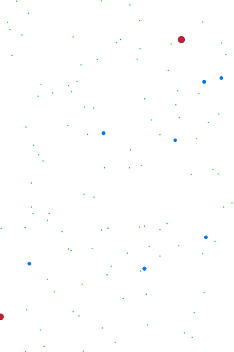

# pond

A simple 2D physics engine and pond-ecosystem simulation, written in C on top of
[raylib](https://github.com/raysan5/raylib).

## TODO

- Merge senses with motor functionality for more consistent motion
-- If no repulse or attract, then only wander (noisy acceleration)
- Try to remove all the resets of velocity due to `!isfinite`
